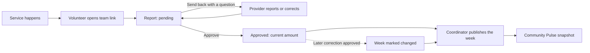
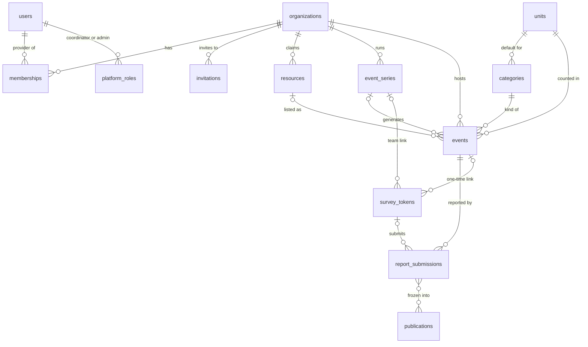

# Daily Help Provider Tools

**Ashland Daily Help · Hackathon design · October 2026**

Ashland Daily Help already shows people where to find a meal, a shower or a navigator. This design adds the other side: organizations sign up, post their services, and send a three-question count after each one. A coordinator reviews the counts and publishes them to Community Pulse.

**Status:** design complete · database schema tested (72 checks pass) · no app code yet · tech stack not chosen

## Files in this folder

Read them in this order:

| File | What's in it |
|---|---|
| `README.md` | This overview |
| `DATA_MODEL.md` | Tables, roles, permissions and every enforced rule |
| `SIGNUP_FLOW.md` | Applying, coordinator checks, invites, edge cases, emails |
| `EVENTS_FLOW.md` | Posting services, repeat patterns, changes, report links, reminders |
| `REVIEW_AND_PUBLISH.md` | The review queue, weekly publishing, corrections, disclosure |
| `schema.sql` | Postgres tables, rules, functions and views, with seed data from the live site |

The diagrams below are written in Mermaid. GitHub, GitLab, Notion and most Markdown editors draw them; in Google Drive they show as text.

---

## 1. What exists today

[ashlanddailyhelp.com](https://ashlanddailyhelp.com/) is a static front end with four views and no backend.

| View | What it does now | What this design changes |
|---|---|---|
| Find resources | 8 hand-entered listings in 5 categories, with a source and review date on each. Search, a list saved on the device, print. | Orgs claim and confirm their own listings; each listing shows its next service times. |
| Provider preview | A practice 3-question report and a simulated coordinator step. Nothing leaves the browser tab. | Real accounts, real reports, real review. |
| Community Pulse | Charts of one fictional week: counted vs estimated, "lanterns" for who reported, unmet need. | Shows real weeks, published by a coordinator. |
| About | Promises no accounts or trackers for the public, and lists four team roles, all "Unassigned". | Those promises still hold for the public. The roles map onto coordinator and admin logins. |

The site's report checks, review queue and dashboard maths are careful and already written. The schema keeps their rules exactly, so the existing pages can sit on top of the new data with few changes.

## 2. How it fits together

1. **Sign up:** an org applies from a phone in about 5 minutes. A coordinator calls it back on its public number to verify it.
2. **Post:** it posts its services once, as a repeating series ("every Tuesday 5–7pm"). Dates appear on the public schedule.
3. **Report:** a volunteer gives three taps and one number from a link the team bookmarked. No account.
4. **Review:** a coordinator checks. Flags point at likely typos, and most weeks are one "Approve all without flags" click.
5. **Publish:** every Thursday, last week goes public as a frozen snapshot on Community Pulse.

## 3. Who logs in

The site itself describes "separate provider, coordinator and technical roles." That gives three login types. Volunteers and the public never log in.

| Login | Who | Does |
|---|---|---|
| **Provider** | Staff or volunteer leads at OHRA, Peace House, ACCESS, a church meal team | Applies for the org, posts events, shares report links, corrects reports, invites colleagues, chooses whether the org's totals are public |
| **Coordinator** | The adopting team's hub staff, not part of any provider they review | Approves orgs and listing claims, reviews reports, publishes weeks |
| **Admin** | One or two technical maintainers | Invites coordinators and admins, manages units, releases and backups |

**No login:**

- **Volunteers** report through a link. The hub stores nothing about who received it.
- **People seeking help** keep the site's promise: "No account needed."
- **Navigators and funders** use the public site and the CSV.

**Ground rules:**

- All providers in an org are equal. There's no owner to lose.
- An approved org always keeps at least one provider.
- Sign-in is by emailed link, with no passwords.
- A coordinator can't review their own org, so the team needs at least two coordinators.

## 4. One survey for everything

Food, showers, shelter, health and essentials all get the same three questions. Only the wording of question 2 changes. It comes from the event's one **unit**, which the category pre-fills.

> **Tue, Oct 20 · Uncle Food's Diner**
>
> 1. Did it happen? **As planned** · Partly · Canceled · Not sure
> 2. How many meals were served? **58** · **Counted** · Estimated · Not recorded
> 3. Was there need you couldn't meet? Yes · **None seen** · Didn't check
>
> *Please don't include names or details about anyone. "Canceled" or "Not sure" skips question 2; no amount is assumed.*

| Category | Default unit | Question 2 reads |
|---|---|---|
| Food & meals | `meals` | How many meals were served? |
| Showers & laundry | `sessions` | How many shower or laundry sessions? |
| Health connections | `encounters` | How many conversations with a navigator? |
| Shelter & housing | `encounters` | How many conversations with a navigator? |
| Everyday essentials | `items` (new) | How many kits or items were handed out? |

Every unit counts servings or visits, never unique people. Unknown is stored as blank, never zero. Different units are never added together.

## 5. Data model

Postgres, 14 tables. The existing site's `resources`, `demoEvents` and `reports` become `resources`, `events` and `report_submissions`, with the same field names and allowed values. Full detail is in `DATA_MODEL.md` and `schema.sql`.

| Table | Holds |
|---|---|
| `organizations` | A provider org and its application and review outcome |
| `users` · `memberships` · `platform_roles` | Logins: provider membership, or coordinator/admin role |
| `invitations` | Emailed invites to an org or a platform role. Single use, expiring. |
| `resources` · `categories` · `units` | The existing directory, plus what each kind of service counts |
| `event_series` · `events` | Repeating patterns, and one row per date |
| `survey_tokens` | Report links: a team link per series, or a one-time link per event |
| `report_submissions` | The three answers, with review status. Every version is kept. |
| `publications` | Frozen weekly snapshots that Community Pulse reads |
| `audit_log` | Every approval, rejection, publish and role change |

## 6. Org sign-up

Full detail is in `SIGNUP_FLOW.md`.

**The provider applies:**

- Enters an email and taps the emailed link. This verifies the email and keeps bots out without a CAPTCHA.
- One screen about the group. A website is optional, so church meals and mutual aid groups can apply.
- Ticks which existing listings they run.
- Agrees to "counts only, never names."
- While pending they can draft events, but nothing shows publicly.

**A coordinator reviews:**

- Checks the group is real: a website, a listing, or a vouch from a known partner.
- **Calls back on the org's public number**, not the one in the form. This stops anyone posing as OHRA.
- Approves (choosing which listings to grant), asks a question, or rejects with a reason.

Once approved, any provider can invite colleagues by email. An invite works once, for that email only, and expires in 7 days. If a whole team leaves, a coordinator re-verifies by phone and sends a fresh invite.

## 7. Events and report links

Full detail is in `EVENTS_FLOW.md`.

A provider's home screen has three lists: **Needs a report**, **Coming up**, and **Your regular services**. Adding a service is one form, pre-filled from the org's listing.

**Repeating, kept simple:**

- Every week on chosen days (OHRA showers: Tue, Thu)
- Every month on the 1st–4th or last weekday (a pantry on the 2nd Saturday)
- A nightly job keeps 8 weeks of dates ahead. "5pm" stays 5pm across daylight saving.
- Cancel or move one date; later series edits leave it alone.
- Series edits rebuild only future dates with no report, so history is never rewritten.

**Getting the count back:**

- **Team link**, one per regular service. The lead bookmarks it, or tapes its QR code in the serving cart. It opens the latest date that still needs a report (within 7 days).
- **One-time link** for one-off events. It works once and expires after 7 days.
- The provider can get a new link if one leaks. A suspended org's links stop working.
- One reminder email the day after an unreported service, plus a Monday digest.

The public sees "Next times" on each listing and a printable "This week" schedule. Canceled dates show "Canceled" and count as canceled, never as zero.

## 8. Review and publishing

Full detail is in `REVIEW_AND_PUBLISH.md`.

| When | What happens |
|---|---|
| During the week | Reports arrive and wait as pending |
| Monday | Reminder digests go out. Coordinators see "14 waiting, 2 not reported." |
| Mon–Wed | Coordinators work the queue |
| Thursday | Last week is published to Community Pulse |

**The queue:**

- Flags: `correction` (shows the old value), `higher_than_usual` or `lower_than_usual` (vs. the 8-week median), `late`, `partial_without_amount`
- A normal week is **Approve all without flags**, then a look at the few flagged rows.
- Coordinators never edit a number. They **send it back with a question**, and the approved amount stays meanwhile.

**Publishing:**

- Allowed once the week is over and nothing is pending. Unreported events publish as "awaiting report".
- Freezes a snapshot in the same shape the current Community Pulse page draws.
- A later correction changes nothing publicly until it's republished as **revision 2**, with a required public note. Revision 1 is kept.

## 9. Privacy decisions

- **No person-level data anywhere.** No client records, unique-visitor counts or demographics, which matches the About page's statement that individual service histories are outside the pilot.
- **No free text on reports.** People tend to type names into free text. The only free text is a coordinator's note, which is never published.
- **Consent controls publication.** Only orgs that agreed to publish appear, in totals or lanterns.
- **No small-number suppression.** Everything published counts servings or visits, not people. Revisit this if a person-level field is ever added.
- **Volunteer links carry no identity.** The hub records which provider shared a link, never who opened it.
- **The public stays account-free and tracker-free**, as the site promises today.

## 10. What's tested

The schema runs in Postgres (PGlite) with four test suites. Each rule was tried with bad input and refused it.

| Suite | Checks | Highlights |
|---|---:|---|
| Reports | 9 | Reproduces the site's sample week (220 meals = 124 counted + 96 estimated; 42 sessions). A correction replaces rather than adds. A canceled event can't carry an amount. |
| Sign-up and invites | 13 | Can't grant a listing another org holds. An invite works only for its own email, once. Can't remove an org's last provider. |
| Events and links | 25 | Tue/Thu, 2nd Saturday and last Friday dates come out right. Times hold across daylight saving. A link can't double-report or report before the event starts. |
| Review and publishing | 25 | The published snapshot matches the sample week, with a non-consenting org's 500 meals excluded. A correction publishes as revision 2 (226 meals) only after republishing. |

The test scripts are JavaScript, so they aren't in this folder. Ask if you want them.

## 11. Open decisions

1. **Work with the original site team?** Extend their front end, or build a separate provider portal that feeds it. The design fits either.
2. **Tech stack and sign-in library.** Postgres is assumed; the app framework and email sign-in provider are not chosen.
3. **Shelter unit.** Add `bed_nights` now, or keep shelter on `encounters` for the pilot.
4. **Application review time** to promise providers ("usually 2 working days"?).
5. **Publish day:** Thursday or Friday.
6. **Late reports:** should providers see unreported events older than 7 days?
7. **Text reminders:** worth storing a team lead's phone number? Currently no, for privacy.
8. **"This week" schedule** as the phone home page. Needs a design pass with the site's team.
9. **Funder access** to the coordinators' all-providers view. That's a consent conversation with providers.

---

*Based on the live site at ashlanddailyhelp.com as of October 24, 2026.*
